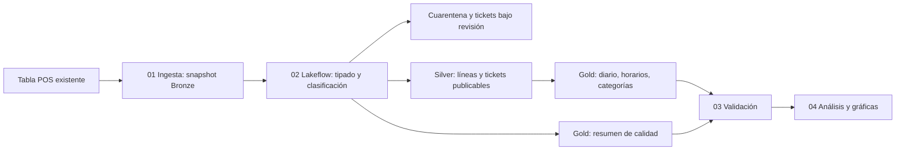

# Astro · Taco Bueno

Pipeline de análisis de ventas POS: importe reportado, transacciones, categorías,
horarios y calidad. Implementación en notebooks Databricks source (`.py` con celdas),
Lakeflow Spark Declarative Pipelines y un Job desplegable mediante bundle.

Estado: entorno `demo` desplegado en Databricks y ejecución sintética realizada;
la verificación se registra en `docs/execution_evidence.md`. No validado con datos
reales: la cuenta actual no tiene SELECT sobre la fuente. Fuente identificada por metadatos:
`workspace.default.tb_daily_tld_01_01_2026_m`; falta confirmar su semántica.
Los Excel GRC pertenecen a otro dominio y no se usan aquí. El PDF previo se usa
como contexto del proyecto, no como evidencia de resultados de esta implementación.

## Flujo



## Archivos

- `notebooks/00_demo_source.py`: datos sintéticos, ejecución manual opcional.
- `notebooks/01_ingest.py`: contrato de entrada y snapshot Delta atómico.
- `notebooks/02_transform.py`: materialized views Silver/Gold, expectations y clustering.
- `notebooks/03_validate.py`: reconciliación de registros, tickets y agregados.
- `notebooks/04_analysis.py`: consultas y gráficas sobre las tablas finales.
- `notebooks/05_source_diagnostics.py`: diagnóstico manual de solo lectura para
  confirmar grano cuando se conceda SELECT; no pertenece al Job diario.
- `resources/`: configuración del Job y pipeline; `databricks.yml`: bundle.
- `docs/`: contrato, operación y guía para presentar la rúbrica.
- `tests/`: pruebas de semántica SQL con fixtures sintéticos.
- `dashboards/astro_demo.lvdash.json`: dashboard de demostración en borrador;
  se regenera con `python scripts/build_demo_dashboard.py`.
- `docs/execution_evidence.md`: resultados y enlaces de las ejecuciones reales
  de la demo; `docs/source_access.sql`: permisos que debe gestionar el propietario.

## Antes de ejecutar

Se necesita un workspace con Unity Catalog, Lakeflow serverless y serverless
para notebooks/Jobs habilitados, y permisos para crear tablas/esquema y ejecutar
estos recursos. El SQL Warehouse existente no sustituye al compute de notebooks.
Verificar disponibilidad de pandas/matplotlib en el entorno serverless antes de correr análisis.
El código usa `pyspark.pipelines` dentro del runtime administrado de Lakeflow.

1. Obtener `catalog.schema.table` de la fuente POS. Revisar [contrato](docs/data_contract.md).
2. Confirmar `amount_grain=line` o `check`: aplica a Total, Tax y Total Discount.
   Si los tres campos tienen granos diferentes, adaptar el contrato antes de ejecutar.
   El valor por defecto `unconfirmed` bloquea la ingesta.
3. Usar `workspace.astro_taco_dev` como destino nuevo y exclusivo. La ingesta
   y el pipeline rechazan esquemas que no empiecen con `astro_`.
4. Autenticarse con Databricks CLI; nunca guardar tokens en Git.
5. Crear `.databricks/bundle/dev/variable-overrides.json` (ignorado por Git):

```json
{
  "catalog": "workspace",
  "schema": "astro_taco_dev",
  "source_table": "workspace.default.tb_daily_tld_01_01_2026_m",
  "amount_grain": "unconfirmed"
}
```

```bash
databricks bundle validate -t dev
databricks bundle deploy -t dev
databricks bundle run daily_orchestration -t dev
```

Reemplazar `unconfirmed` solo tras validar el grano con el equipo. Los comandos
anteriores del target `dev` son instrucciones para una ejecución futura.
El bundle fija el host del equipo; usar `--profile ASTRO` con la CLI si se requiere.
La programación de las 06:00 America/Monterrey está pausada. Activarla en el Job
solo después de verificar la primera ejecución, permisos, costo y datos.

## Alternativa desde la interfaz

Importar `notebooks/*.py` como notebooks o abrir el repo con Git folders en Databricks.
Ejecutar 01 con sus widgets. Crear pipeline Lakeflow con 02 como biblioteca,
catálogo/esquema destino y configuración `astro.catalog`, `astro.schema`.
Ejecutar el pipeline y después 03 y 04. Para automatizar: crear Job con tareas
notebook 01 → pipeline 02 → notebook 03 → notebook 04; usar serverless en las tareas
de notebooks y pasar catálogo/esquema en widgets.
02 no se ejecuta con Run All en un cluster convencional.

## Demo de extremo a extremo

El target `demo` configura el esquema `workspace.astro_taco_demo`, fuente sintética
y grano `check`, sin cambiar la configuración del target `dev` para datos reales:

```bash
databricks bundle validate -t demo --profile ASTRO --strict
databricks bundle deploy -t demo --profile ASTRO
databricks bundle run seed_demo -t demo --profile ASTRO
databricks bundle run daily_orchestration -t demo --profile ASTRO
```

Ejecutar secuencialmente: no iniciar daily_orchestration hasta que termine seed_demo.

Importar y ejecutar 00 manualmente con un esquema terminado en `_demo`. Usar su
tabla `demo_pos_source` como `source_table`, el mismo catálogo/esquema y
`amount_grain=check`. Ejecutar el Job completo. Resultado esperado: 8 filas Bronze,
7 Silver, 1 cuarentena, 2 tickets publicados, 3 tickets bajo revisión e importe
publicado 18. La duración del ticket 101 es 180 segundos al cruzar medianoche.
Los resultados se identifican con `is_demo=true`; no presentarlos como negocio real.

## Pruebas locales

```bash
python -m pip install -r requirements-test.txt
python -m unittest discover -s tests -v
```

Las pruebas ejecutan las consultas de clasificación y agregación del notebook
contra DuckDB. No prueban el parser de fechas/tipos de Spark, Delta, decorators,
clustering, permisos, despliegue ni el motor Lakeflow. Completar estas verificaciones
en el workspace con la demo antes de usar la fuente real.

Consultar [operación](docs/runbook.md) y [rúbrica y presentación](docs/rubric.md).
El [inventario y plan de compatibilidad](docs/workspace_compatibility.md) explica
qué existe en el equipo y cómo migrar los dashboards sin sobrescribirlos.
