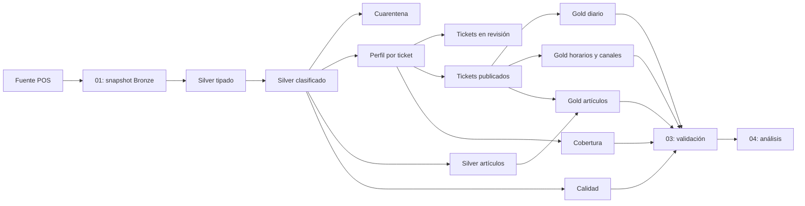

# Arquitectura de la demostración

## Alcance

Dos días reales (2025-12-31 y 2026-01-01) ya disponibles en una tabla del
workspace. La tabla histórica grande es contexto, no un requisito de ejecución.
La ingesta actual es tabla-a-tabla. Si el evaluador exige archivos externos,
conservar además evidencia del archivo y su carga original.

## Dependencias

La configuración reside en resources; Lakeflow descubre los archivos de
src/transformations y determina las dependencias por sus consultas.
Los notebooks no contienen definiciones de tablas Silver/Gold.

## Operación

Snapshot Delta atómico, una ejecución concurrente por job, etapas dependientes,
reintento de ingesta, timeouts y schedule pausado. Un refresh parcial no es
evidencia válida hasta completar la validación. No realizar una carga Bronze
concurrente desde otro job/pipeline sobre el mismo esquema.

Se usa batch porque la entrada es un snapshot mutable y no hay identidad de
evento append-only confirmada. Las materialized views permiten refresh gestionado;
no se promete que todas las consultas sean incrementales. Clustering por
fecha/tienda se configura en tablas principales; medir su beneficio antes de
afirmar mejoras de rendimiento. Ver runbook para recuperación y límites.

## Destinos y procedencia

Main real usa workspace.astro_taco_main_real; main sintético usa
workspace.astro_taco_main_demo. Astro_taco_dev es un despliegue distinto
propiedad de Magda. La ingesta fija una versión Delta, registra su número,
y comprueba la propiedad de tablas existentes antes de sustituir Bronze.
