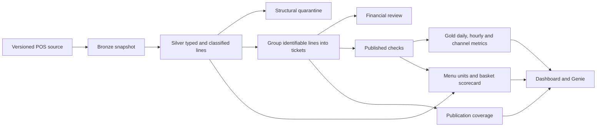

# Taco Bueno pricing and promotions | Final pitch source brief

**Team Astro · Phase 2 Databricks datathon · Evidence through November 19, 2026**

Use this document as source material for an English presentation to restaurant operators, BI analysts, and technical judges. The eight-slide outline near the end fits approximately five minutes. The rest supplies the numbers, definitions, and answers the team can use during questions.

## 1. The mission behind the project

The Taco Bueno datathon brief asks which promotions should continue, stop, or return. Management would like to know whether an offer increases demand, whether its results depend on the season, and whether it draws orders away from other menu items. This is the **business mission assigned to Team Astro**. The wording is our description of the challenge, rather than a quotation from Taco Bueno leadership.

Imagine a menu manager considering a taco offer. Three questions lead to three different decisions. How often do guests order that taco? That helps describe demand. Does the taco appear more often in baskets with a discount? That helps select an offer to investigate. Would running the offer cause customers to buy more across the category? That requires a verified offer and a credible comparison. Our published pipeline answers the first two questions within the observed dates and identifies the evidence needed for the third.

A good opening line for the pitch is **“If two stores record a discount differently, how can Taco Bueno tell which menu offers deserve another test?”** Start with a menu decision, follow it back to the receipt lines, and return to the decision with a concrete example.

## 2. What data we have

| Data asset | Scope | How to use it |
|---|---|---|
| Validated POS extract | December 31, 2025 and January 1, 2026. 284,428 source rows, 114 stores, 40,306 identifiable tickets | Source of the published dashboard, menu scorecard and financial findings in this brief |
| Published tickets | 40,257 tickets passed the publication rules. The other 49 are available for financial review | Denominator for basket metrics. Publication coverage is 99.8784% of identifiable checks |
| Historical POS source | Earlier feasibility scan found 85,273,331 rows, 119 stores and 573 distinct parsed dates between January 22, 2025 and September 27, 2026 | Candidate for comparable weekday and offer studies after validating financial rules, coverage and offer identity across history |
| Isolated synthetic fixture | 12 deliberately constructed input rows, 11 structurally valid rows and one quarantined row. Five tickets published, two held for review | Demonstrates failure cases with known answers, including an invalid date, even when the real extract has zero structural rejections |

The real source is `workspace.default.tb_daily_tld_01_01_2026_m`. Its fields describe a store, business date, check number, menu item, reporting category, price, quantity, tax, discounts, voids, transaction type, channel and POS times. Repeated item lines are common. A line can represent a priced item, a combo component, a modifier or a monetary adjustment. A source line, a unit and a ticket answer different questions.

The available schema gives us no confirmed campaign identifier, campaign calendar, customer identity or product cost. Prices and amounts below are in **source monetary units**. Use plain numbers on slide labels because the extract does not confirm a currency. Customer amount includes tax. Merchandise amount excludes tax after discounts. Claims about cash settlement, profit or return on investment require other records.

## 3. How the pipeline works from end to end

**Ingest.** A Databricks Job reads an existing Delta table, records the source version, and takes a batch snapshot. The October demonstration used Delta version 1. Bronze retains the source identity, load time, amount grain and real/demo flag. Before replacing Bronze, ingestion checks ownership of existing pipeline outputs. That protects the shared workspace from accidentally writing into another pipeline's schema.

**Transform.** Lakeflow reads the transformation definitions and resolves their dependencies. Silver parses dates, times and numeric values, standardizes categories, classifies lines and reconstructs checks. Gold aggregates published data into tables with defined units of analysis. The menu scorecard combines eligible item lines with the published ticket population.

**Validate.** A separate job task checks that rows and tickets reconcile, the published ticket key is unique, financial equations hold, and downstream daily, hourly and channel results agree with Silver. A failed job validation blocks the dependent analysis task. Structural quarantine and financial review remain visible for investigation.

**Analyze and serve.** The analysis notebook generates bounded comparisons and charts. The AI/BI dashboard queries Silver and Gold through a SQL warehouse. Genie answers follow-up questions using curated tables and documented financial definitions. Dashboard publication is a separate operation. The November 19 real job completed all four tasks and the dashboard deployment verified its SQL queries.

**Operating model.** The configured daily trigger is 6:00 a.m. in America/Monterrey and is paused. Each run snapshots the configured source table. A fresh date requires upstream data and financial rules valid for the relevant store and date. The two-day run and its repeat establish reproducibility on a fixed input. Automatic discovery of daily files and continuous streaming are outside the demonstrated workflow.

## 4. Three transformations worth explaining aloud

### A receipt can repeat the total on every item line

Consider two illustrative rows, one taco and one drink, each showing a ticket total of 10.80. Summing the column would report 21.60 for one check. Silver groups by store, business date and check number, checks that repeated header fields agree, and counts the amount once. The pipeline also keeps real and demo data separate. A customer buying two identical items can generate two legitimate occurrences, so deleting every identical line would change the basket.

The team tested this choice on the actual extract. Applying blanket deduplication would reduce the number of tickets matching the inferred accounting equations from **40,267 to 24,652**. This makes a strong oral example of how an apparently tidy transformation could damage the data.

### Stores use two conventions for the field named Total

| Observed profile | Stores | Customer amount including tax | Merchandise amount after discount, excluding tax |
|---|---:|---|---|
| A | 78 | Source Total | Total minus Tax |
| B | 36 | Total minus ticket discount plus Tax | Total minus ticket discount |

The rules are scoped by store and valid dates. The team inferred them by comparing item arithmetic to repeated ticket fields across all 40,306 identifiable checks. For a real example from store 5261, extended item prices sum to 18.53, discount is 3.71 and tax is 1.22. The source Total is 18.53. The comparable merchandise amount is **14.82** and customer amount is **16.04**. At store 5026, the recorded Total of **23.14** already includes tax after discount. Subtracting the discount again would understate that basket.

Across published checks, summing the mixed source Total gives 605,737.62. The normalized customer amount is 615,846.68. The difference comes from reconciling definitions. It is not a gain in sales.

### Promotions leave different traces in the register

Profile A contained **254 negative-price lines labeled Item Promo across 241 tickets**. All 241 matched that profile's equation. Profile B contained **647 tickets** with a Discount transaction-type line. On all 647, item discounts summed to the ticket-level discount. A search for the literal label Discount would miss the first recording pattern.

The transformation preserves those monetary adjustments while preventing them from inflating product units. Similarly, a zero-quantity component contributes zero units, and a partial void can leave a valid remainder on the check. These rules explain why product units, positive ticket discounts and identified campaign redemptions require separate definitions.

## 5. Where to find each answer

Published project schema: `workspace.astro_taco_main_real`. The table grain tells the analyst which rows can be added or compared.

| Table | What one row represents | Question it answers |
|---|---|---|
| `bronze_pos` | Source line with ingestion metadata | Which extract and version produced this record? |
| `silver_store_financial_profiles` | Store rule and validity interval for a data environment | Which financial convention applies on this date? |
| `silver_pos_typed`, `silver_pos_classified` | Typed or classified source line | How were dates, amounts, discounts, repeated lines and voids interpreted? |
| `silver_pos`, `silver_pos_quarantine` | Structurally valid line or rejected line with reason | Which lines passed structural checks? |
| `silver_checks_profile` | Identifiable ticket with profile, residual and publication decision | Does its financial calculation reconcile? |
| `silver_checks`, `silver_checks_review` | Published ticket or withheld ticket with reason | Which tickets contribute to reported amounts? Why was a ticket withheld? |
| `gold_daily_sales` | Store and business date | How many transactions occurred, and how did volume and average ticket change? |
| `gold_hourly_sales`, `gold_channel_hourly` | Store/date/POS hour, with channel on the latter table | When did demand occur? How was it distributed across recorded channels? |
| `gold_menu_performance` | Store/date/category/menu item | What did people order in reported units? Bundle components need interpretation. Product-level revenue is intentionally unallocated. |
| `gold_menu_discount_scorecard` | Observed store/date/category/priced item | How frequently does the item appear in published baskets with a positive ticket discount versus zero ticket discount? |
| `gold_publication_coverage` | Store and business date | What fraction of identifiable tickets was published for the selected window? |
| `gold_quality_summary` | Entire source snapshot | How many rows had unknown categories, missing durations or possible repeats? Store/date filters do not change these snapshot totals. |

For a chainwide average ticket, divide total normalized customer amount by total published tickets. An unweighted average of store averages gives small stores disproportionate influence. When comparing quantities with ticket amounts, aggregate each table to a compatible grain before joining. Otherwise a single receipt can contribute its full amount once for every item.

## 6. Slide-ready results

### Demand increased while average ticket fell

| Business date | Stores | Published tickets | Customer amount incl. tax | Merchandise after discount excl. tax | Average ticket |
|---|---:|---:|---:|---:|---:|
| Dec 31, 2025 | 114 | 16,017 | 261,359.34 | 242,847.26 | 16.32 |
| Jan 1, 2026 | 114 | 24,240 | 354,487.34 | 329,026.90 | 14.62 |
| Both dates | 114 distinct | 40,257 | 615,846.68 | 571,874.16 | 15.30 |

January 1 had **51.34% more tickets**. The average customer amount per ticket fell by about 1.70. Show two pairs of bars with separate labeled scales. The practical interpretation is that volume and basket value moved in opposite directions across these holiday dates. The comparison alone cannot identify a promotion as the cause.

### Discount incidence and depth describe different things

**2,576 of 40,257 published tickets** had a positive reported ticket discount, or about **6.4%**. Reported ticket discounts totaled **9,377.79** when counted once per published check. Discount depth was about **1.61%**, calculated as total ticket discounts divided by merchandise after discounts plus those discounts. Incidence answers how widespread the ticket discount was. Depth measures its size relative to the merchandise base. A generic Item Promo adjustment may be recorded differently, so the 6.4% figure specifically describes the positive ticket-discount field.

### A real menu example for the final pitch

The native SQL scorecard produced **17,275 store/date/category/item rows across 114 stores**. Read the following two observations directly from the saved dashboard query output. Select the corresponding date and store on dashboard tab 4 to reproduce each one.

| Item and observation | With positive ticket discount | With zero ticket discount | Difference per 100 baskets |
|---|---:|---:|---:|
| Beef Crispy Taco, store 8286, Jan 1 | 4 of 26 baskets (15.38%) | 39 of 251 (15.54%) | -0.15 percentage points |
| Grilled Chicken Taco Rollup, store 8714, Dec 31 | 1 of 4 baskets (25.00%) | 10 of 132 (7.58%) | +17.42 percentage points |

**What to say:** “At store 8286, Beef Crispy Taco appeared in about 15 out of every 100 baskets in either group. At store 8714, the rollup shows a larger gap, but just one discounted basket contained it. Before choosing an item for a promotion test, we would check whether the pattern repeats across comparable stores and weekdays.”

These are deliberately contrasting examples of how to read the scorecard. The rows are individual observations, not portfolio rankings. An item counts once per basket even if the customer bought three. The comparison includes named, positive-price, positive-quantity sale or discounted items from published tickets. Some priced lines can still represent combos. The ticket-level discount does not tell us which item received it. A group with no tickets has an undefined rate, displayed as blank. Sum item counts and obtain pooled cohort sizes from published tickets when extending the calculation across stores. Summing the displayed denominators across items repeats baskets.

## 7. How to demonstrate quality

| Rubric dimension | What the team checked | Evidence to show |
|---|---|---|
| Completeness | Bronze rows equal structurally valid rows plus quarantine. Identifiable checks split into published and review. | 284,428 = 284,428 + 0 real rows. Separately, 40,306 = 40,257 + 49 tickets. Completeness here concerns the supplied extract. |
| Consistency | Daily store aggregates match published checks. Hourly and channel totals also reconcile. | The same snapshot produced identical counts and normalized amounts on rerun. |
| Validity | Typed fields, valid keys, plausible durations, known financial profiles and supported line roles. | The synthetic bad date entered quarantine. On the real extract, 20,804 rows lacked a usable duration. |
| Uniqueness | One published check per composite ticket key. Repeated item occurrences are preserved for reconciliation. | Show the two-row 10.80 illustration alongside a repeated-item test. |
| Accuracy | Inferred equations, repeated header fields and customer/merchandise/tax identities. | 39 equation exceptions are among the 49 held checks. Other review reasons overlap. External receipt or settlement confirmation is unavailable. |

Two qualifications matter to the dashboard audience. All 284,428 normalized rows have unknown tender type, so avoid payment-method comparisons. There are 741 missing item names and 741 rows with unknown category. Describe those as row counts. Also, **99.88% is publication coverage**, not the probability a ticket is correct. The local suite passed 29 tests including the new scorecard check. Warehouse execution verified 12 dashboard datasets and all 25 data widgets. The deployment evidence records SQL and API verification; a visual browser pass is a separate check.

## 8. How the team addressed the rubric and went further

| Evaluation area | What meets the rubric | Distinguishing evidence or design choice |
|---|---|---|
| Repository and documentation | Orchestration under resources/jobs and resources/pipelines. Silver and Gold under src/transformations. Runbook and definitions in docs. | A reviewer can trace one business metric from native SQL through its fixture test into the dashboard. The synthetic seed job is isolated to its demo target. |
| Job and pipeline design | Ordered ingest, transform, validate and analyze tasks with retry and timeout settings. | Versioned snapshots, ownership checks and rerun evidence make the pipeline easier for another team to operate. |
| Transformations and table value | Clean POS data and publish ticket, store, menu and channel outputs. | Two scoped store conventions and multiple promotion recording patterns were discovered from the data. Their treatment changes the business interpretation. |
| Streaming, materialized views, liquid clustering and expectations | Batch suits a mutable source snapshot. Lakeflow manages materialized views. Expectations monitor or enforce specific conditions. | Date/store clustering is configured on published checks and daily sales to match common queries. Quantified speed or cost gains would require a measured comparison. |
| Data quality | All five dimensions above have named checks and evidence. | Real exceptions and deliberately constructed failures are inspectable separately. Analysts can see what fraction of tickets contributes to a result. |
| Analysis and business value | Date, store, channel, menu and discount comparisons connect to business questions. | The scorecard pairs rates with sample sizes and a decision board gives a specific next experiment. |
| Technical communication | One business question connects source, transformation, check and finding. | A live drill-down and a Genie question let a judge challenge the interpretation and see where the numbers came from. |

Maintainability is easiest to show with the scorecard itself. The team added one SQL definition to Gold, reused the existing published checks and classified item lines, tested repeat handling and missing comparison groups, then connected the result to the existing dashboard and Genie space. The job already discovered transformation files in that directory. This is a demonstrated example of extending the pipeline after the original delivery.

## 9. Demo route and the next business decision

The six dashboard pages cover business overview, pricing and discounts, demand and comparison readiness, menu mix, decisions and experiments, and trust and pipeline evidence. For a short demo, begin on **tab 4**, select store **8286** and **January 1**, locate Beef Crispy Taco and read both fractions aloud. Move to **tab 6** to explain which checks entered the denominator. Close on **tab 5** with the proposed investigation. Its recommendations describe the full snapshot. The source-quality and provenance tables also have snapshot-wide scope. Genie can answer a follow-up such as “How many published checks and stores are in this comparison?” Give the store and date explicitly when asking.

The historical source makes a concrete follow-up possible. An exploratory scan found **1,292 rows labeled School Special (NR)** across 115 stores and **225,136 rows labeled Item Promo** across 115 stores. A label count does not establish offer redemptions or official campaign dates. Validate the meaning of a candidate label, extend the financial rules over the chosen period, and identify stores and weekdays with comparable coverage. Compare target-item frequency, likely substitute units, category totals and basket merchandise amount. A rise for one item alongside flat category demand warrants a substitution investigation. A controlled or otherwise defensible comparison would support a future keep, stop or return decision.

## 10. Suggested five-minute deck

| Slide | Seconds | Takeaway on screen | Evidence or visual |
|---|---:|---|---|
| 1. Which taco offer deserves another test? | 20 | Taco Bueno needs to understand menu demand and how discounts appear on receipts. | One business question and the two observation dates. |
| 2. Follow a receipt through the pipeline | 35 | A versioned source becomes validated tickets and Gold tables. | Redraw the flow in section 3. Branch quarantine and financial review off Silver. |
| 3. The same Total field means different things | 45 | Reconstruct the ticket, then apply its store/date rule. | Store 5261 example, including 18.53 source Total and 16.04 normalized customer amount. |
| 4. Account for every row and identifiable check | 35 | All supplied rows are accounted for. 49 tickets were withheld. | Two separate reconciliation equations, plus the synthetic invalid-date example. |
| 5. Volume rose while average basket value fell | 30 | Both dates covered 114 stores. Tickets rose 51.34% while average ticket fell. | Two bar pairs from section 6. |
| 6. A taco on a discounted ticket | 65 | Basket frequency plus sample size determines whether a signal deserves follow-up. | Compare the two real menu examples. Label both numerators and denominators. |
| 7. Another analyst can extend the project | 35 | Adding the scorecard reused the published ticket rules and the existing job. | Gold SQL file → fixture test → dashboard and Genie. Mention managed views and why batch fits. |
| 8. Decision and next experiment | 35 | Verify the offer, extend comparable history, then test target and substitute items together. | One decision today and the evidence needed for a portfolio recommendation. |

### Copy this instruction into Claude with this Markdown file

> Create an eight-slide English deck for a five-minute Team Astro datathon pitch using section 10. Speak to Taco Bueno menu managers and Databricks judges. Give each slide a takeaway headline, one readable visual, and brief speaker notes. Use sections 2, 5 and 7 to prepare optional Q&A notes. Prioritize the real taco scorecard on slide 6, including sample counts and percentage-point units. Use the supplied figures and plain monetary units. Identify the two-day results as observed, the historical scan as exploratory, and the proposed promotion experiment as future work. Use the project mission in section 1 as the team's interpretation of the challenge. Put sources in the notes. Keep screenshots cropped to the metric being discussed.

## Evidence and links

- [Published dashboard](https://dbc-cfb7f93a-b497.cloud.databricks.com/dashboardsv3/01f1d42ecb9314b996d9c68d88de031e/published?o=7474644614542766) · [Genie space](https://dbc-cfb7f93a-b497.cloud.databricks.com/genie/rooms/01f1d42ecb0a156c8ba220f1312dc57c?o=7474644614542766) · [November 19 successful job](https://dbc-cfb7f93a-b497.cloud.databricks.com/jobs/621214800098362/runs/891503667513771?o=7474644614542766)
- [Published BI and scorecard evidence](evidence/promotion-bi-deployment.json) · [Gold scorecard SQL](../src/transformations/gold/mv_menu_discount_scorecard.sql) · [Scorecard regression test](../tests/test_menu_discount_scorecard.py)
- [Real run evidence](evidence/normalized-real-verification.json) · [First real run](evidence/normalized-real-first-run.json) · [Synthetic quality case](evidence/normalized-demo-verification.json)
- [Financial definitions and examples](financial_definition_analysis.md) · [Reproducible analysis SQL](../validation/final_analysis.sql) · [Historical profile and methodology](dashboard_plan.md)
- [Repository layout](repository_structure.md) · [Job configuration](../resources/jobs/daily_orchestration_job.yml) · [Pipeline configuration](../resources/pipelines/lakeflow_pipeline.yml) · [Rubric mapping](rubric.md)
